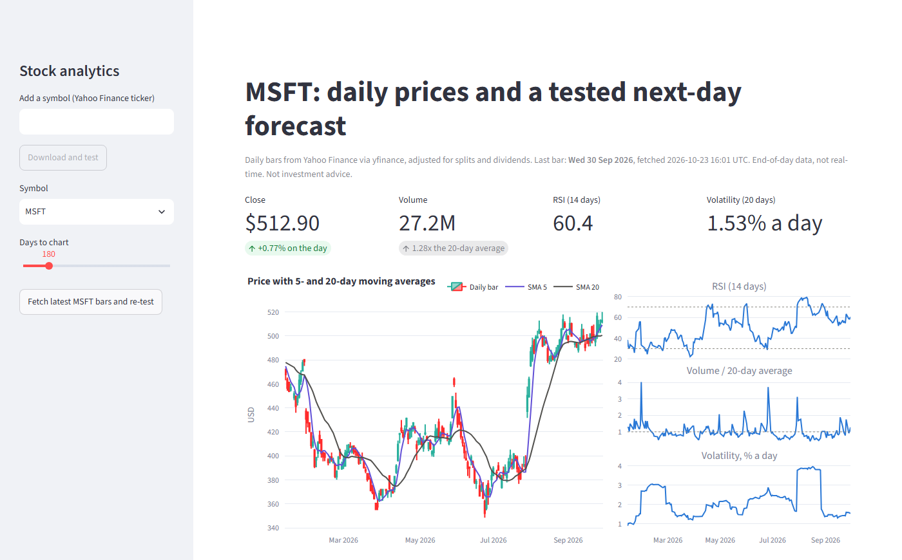
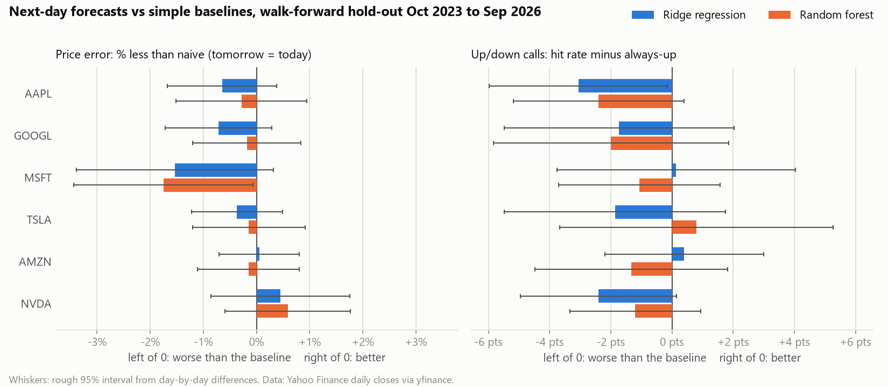
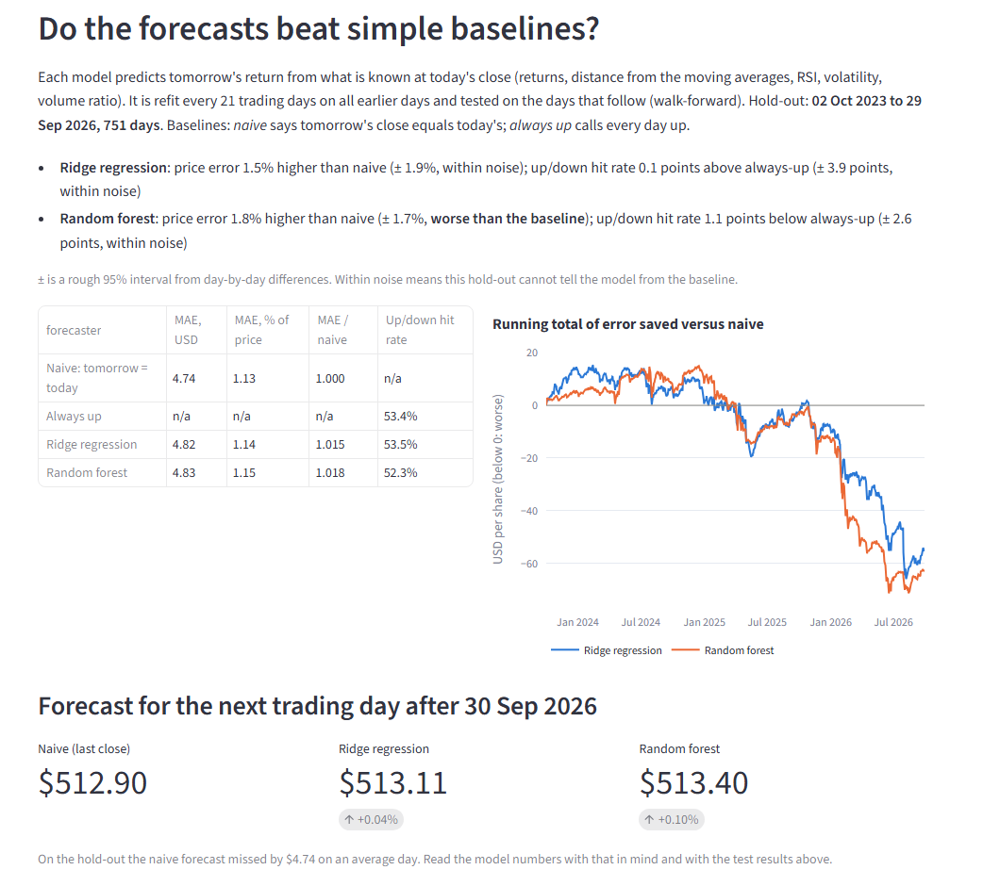

# Stock analytics dashboard

A small data pipeline and Streamlit dashboard for daily US stock prices. It downloads daily bars from Yahoo Finance, stores them with five technical indicators in SQLite, and tests two next-day price models against simple baselines over three years, with every forecast made by a model trained only on earlier days. It is for anyone who wants to see how a stock forecast should be checked, and what an honest check shows: on this data the models do not beat "tomorrow's close equals today's".



## Results

Data: daily bars for AAPL, GOOGL, MSFT, TSLA, AMZN and NVDA from 4 Jan 2016 to 30 Sep 2026 (2,701 trading days each). Hold-out: one forecast at the close of each of the 751 trading days from 2 Oct 2023 to 29 Sep 2026, per stock. The models are refit every 21 trading days on all earlier days (walk-forward with an expanding window), so each forecast uses only data from before it.

Baselines:

- **Naive**: tomorrow's close equals today's close.
- **Always up**: call every day an up day (for the up/down hit rate).

MAE is the mean absolute error of the next-day close. "MAE / naive" below 1 means the model beats naive.

| Symbol | Hold-out days | Naive MAE (% of price) | Ridge MAE / naive | Forest MAE / naive | Always-up hit rate (%) | Ridge hit rate (%) | Forest hit rate (%) |
|---|---:|---:|---:|---:|---:|---:|---:|
| AAPL | 751 | 1.15 | 1.006 | 1.003 | 54.06 | 51.00 | 51.66 |
| GOOGL | 751 | 1.39 | 1.007 | 1.002 | 54.19 | 52.46 | 52.20 |
| MSFT | 751 | 1.13 | 1.015 | 1.018 | 53.40 | 53.53 | 52.33 |
| TSLA | 751 | 2.65 | 1.004 | 1.001 | 50.73 | 48.87 | 51.53 |
| AMZN | 751 | 1.45 | 1.000 | 1.002 | 52.06 | 52.46 | 50.73 |
| NVDA | 751 | 2.17 | 0.996 | 0.994 | 54.33 | 51.93 | 53.13 |
| Mean of 6 | 751 | 1.65 | 1.005 | 1.003 | 53.13 | 51.71 | 51.93 |

**Neither model beats the naive price forecast.** Both models land within 2% of the naive error on every stock (mean ratio 1.005 for ridge, 1.003 for the forest). The best case, the forest on NVDA with 0.6% less error than naive, sits inside its rough 95% interval of ± 1.2%, so it is noise. Of the 24 model-versus-baseline comparisons, two are clearly worse than the baseline (the forest's price error on MSFT, 1.8% higher ± 1.7%; ridge's up/down calls on AAPL, 3.1 points below always-up ± 2.9) and none is clearly better.

**Neither model beats always-up on direction.** The stocks rose on 53.1% of hold-out days on average. The models called the direction right on 51.7% (ridge) and 51.9% (forest) of days.

This is the expected result for large, heavily traded stocks: today's indicators say almost nothing about tomorrow's move.



The dashboard runs the same check for the chosen stock and states a verdict for each model, next to the score table and the running total of error saved against naive:



## How it works

1. `stockdash/store.py` downloads daily bars with yfinance, adjusted for splits and dividends. During trading hours Yahoo returns a bar for today that is still moving, so the code drops it until 18:00 exchange time.
2. `stockdash/indicators.py` adds SMA 5, SMA 20, RSI 14 (Wilder's smoothing), volatility (standard deviation of daily returns over 20 days, in %) and volume ratio (volume over its 20-day average). Each value uses only that day and earlier days.
3. `store.py` writes bars and indicators to SQLite at `data/stock_analytics.db`: table `stock_prices`, one row per symbol and day, keyed on both so a re-run replaces rows instead of adding copies.
4. `stockdash/model.py` builds seven features known at the close: 1-day and 5-day return, distance of the close from SMA 5 and SMA 20, RSI, volatility and volume ratio. The target is the next day's return, and the price forecast is today's close times (1 + predicted return). Models: ridge regression with scaling, and a random forest (100 trees, depth 5).
5. The walk-forward test refits both models every 21 trading days on all earlier rows and forecasts the next block. `store.py` saves every hold-out forecast, plus the forecast for the day after the last bar, to the `predictions` table.
6. `stockdash/pipeline.py` runs steps 1 to 5 for each symbol and, with `--report`, `stockdash/report.py` writes `docs/results.md` and `docs/evaluation.png`.
7. `stock_dashboard.py` is the Streamlit app. It reads SQLite and shows the latest numbers, the charts, the test results and the next-day forecast. The sidebar can fetch the latest bars for a symbol or add a new ticker; both re-run the test.

How the test avoids leakage:

- Indicators use trailing windows only. A test changes later prices and checks that earlier indicator values stay the same.
- The scaler sits inside the model pipeline, so each refit learns it from training rows only.
- Every training row comes before every test row. A test changes prices from day 440 on and checks that forecasts made before that day do not move, while later ones do.

## How to run

Python 3.12.

```bash
git clone https://github.com/Letsapatiiso07/stock-analytics-dashboard.git
cd stock-analytics-dashboard
python -m venv .venv
source .venv/bin/activate          # Windows: .venv\Scripts\activate
pip install -r requirements.txt

# Download data, run the walk-forward test, write docs/results.md and docs/evaluation.png.
# These are the settings behind the numbers above. Takes about 2 minutes.
python -m stockdash.pipeline --start 2016-01-01 --end 2026-10-01 --test-start 2023-10-01 --report docs

# Dashboard at http://localhost:8501 (open http://localhost:8501/?symbol=MSFT to pick a stock)
streamlit run stock_dashboard.py

# Tests for the indicator maths and the no-leakage split
python -m pytest
```

Without `--end` the pipeline downloads up to the last finished trading day and tests on the three years before it. Use `--symbols` to pick other tickers.

## Data source

- Yahoo Finance daily bars through the unofficial yfinance library (1.7.0), with `auto_adjust=True`.
- Range behind the results: 4 Jan 2016 to 30 Sep 2026, downloaded on 23 Oct 2026.
- Freshness: end-of-day data only. The app shows the date of the last bar and when it was fetched. Nothing streams, so it is not real-time.
- Yahoo rescales adjusted history when a stock pays a dividend, so a later download of the same range can give slightly different numbers.
- Yahoo's data is for personal use. Check its terms before using it for anything else.
- Downloaded data and the database stay out of git (`data/` is ignored).

## Limits and next steps

- Six large US tech stocks and one three-year hold-out in a mostly rising market. Other stocks or periods may give other results.
- The ± intervals treat days as independent. They are a rough guide, not a formal test.
- The forecast is a single number with no proper interval around it.
- The test ignores trading costs and does not test a trading rule. A better hit rate alone would not mean profit.
- Next steps: a Diebold-Mariano test that allows for autocorrelation, longer horizons (5 and 20 days), quantile models for honest forecast ranges, more sectors and markets (for example JSE stocks), and a daily scheduled run of the pipeline.

This project is for learning. It is not investment advice.

## Author

Tiiso Letsapa, Letsapamyron07@gmail.com
